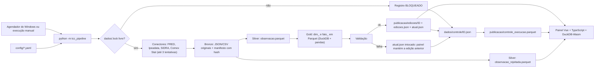

# Engenharia de dados do TCC

**Revisão 5 de 17/11/2026 (alinhada à versão do texto oficial "Cópia de Documentação - TCC" lida em 17/11, capítulos 3 a 7) · Responsável: Lucas Lellis Barros**

Este arquivo substitui o `projeto.md` (revisão de 16/11) como referência da frente de engenharia de dados. Ele reúne as decisões do grupo (D0 a D27, Q1 a Q10), o pedido do Prof. Germano e as simplificações desta revisão.

**Referências vigentes:** `agente.md` (contexto geral), este arquivo (frente de dados) e `consenso-tcc-2026-11-17.md` (complemento). O `alinhamento-tcc-2026-11-17.md` e o `projeto.md` estão superados. O objetivo é implementar menos coisas, sem perder desempenho, rastreabilidade ou aderência ao texto oficial.

**Legenda usada no arquivo**

- **[DECIDIDO]**: fechado pelo grupo ou pelo responsável da frente. Pode ir para o código e para o texto.
- **[PROPOSTA]**: sugestão desta revisão. Validar com o grupo ou com o Prof. Germano antes de entrar no texto oficial.
- **[CONFERIR]**: depende de consulta à fonte. Registrar resultado e data em `config/series.yaml`.

---

## 1. Escopo

- **[DECIDIDO]** Comparação EUA × economia brasileira por indicadores macroeconômicos, em três recessões datadas pelo NBER. **Sem empresas, sem setores, sem recorte latino-americano** (D5).
- **[DECIDIDO]** TCC I entrega o **projeto** da solução: mapa das séries, modelo, regras, contrato e protótipos. A implementação completa é do TCC II. A prova de conceito com 2 ou 3 séries é opcional e desejável.

### 1.1 Episódios

| `id_episodio` | Pico mensal | Vale mensal | Pico trimestral | Vale trimestral |
|---|---|---|---|---|
| `1981-1982` | 1981-07 | 1982-11 | 1981T3 | 1982T4 |
| `2007-2009` | 2007-12 | 2009-06 | 2007T4 | 2009T2 |
| `2020` | 2020-02 | 2020-04 | 2019T4 | 2020T2 |

O pico é `t_rel = 0`. A recessão de 1980 aparece apenas como antecedente dentro da janela de 1981-1982. Cadastro manual em `config/episodios.yaml` (RF05).

---

## 2. Decisões vigentes

| # | Data | Decisão |
|---|---|---|
| D0 | 05/11 | Apache Kafka retirado. |
| D1 | 17/11 | Painel lê **Parquet** da edição publicada com **DuckDB-Wasm** no navegador. **Sem API própria.** |
| D2 | 17/11 | O Lucas define o contrato de saída e entrega ao Gabriel e ao Arthur (seção 8). |
| D3 | 17/11 | Reação exige **meses consecutivos** além do limiar. |
| D4 | 17/11 | Recuperação = tempo, **a partir do mês de pico**, até a série voltar ao nível do pico. Duração da queda (pico até o extremo) é medida separada. |
| D5 | 17/11 | Empresas fora do TCC. |
| D6 | 17/11 | Airflow retirado. Pipeline Python em lote, disparado pelo **Agendador de Tarefas do Windows** ou manualmente, pelo mesmo comando. |
| D7 | 17/11 | **IBGE/SIDRA é fonte oficial** (PIM-PF 8888, IPCA 1737, PIB 1621, PNAD Contínua). Sem puxar o IBGE pelo Ipeadata. |
| D8 | 17/11 | **Exportações brasileiras em par com a produção industrial dos EUA** (`eua_prod_ind`), como canal da demanda americana. Total nos três episódios; Brasil → EUA em 2007-2009 e 2020. |
| D9 | 17/11 | **Juros e inflação com sentido adverso "ambos"**: a reação conta em qualquer direção. |
| D10 | 17/11 | **Exportações em US$ deflacionadas pelo CPI dos EUA** (`CPIAUCSL`), base no pico de cada episódio (RF03). |
| D11 | 17/11 | **Recuperação (complemento da D4):** contada a partir do pico, com a busca pelo retorno começando **depois do extremo**. |
| D12 | 17/11 | **PIB do Brasil em 1981-1982:** trimestral `SEM_DADOS`; taxa anual dos dois países apenas na ficha, fora das métricas. |
| D13 | 17/11 | **SGS retirado.** Fontes oficiais: FRED, Ipeadata, IBGE/SIDRA e Comex Stat. |
| D14 | 17/11 | **Trava por arquivo de lock** (`dados/.lock`) em `atualizar` e `reprocessar` (texto 4.3 e 5.2). |
| D15 | 17/11 | **Observações reprovadas** vão para `observacao_rejeitada.parquet` com o motivo e não entram na Gold (texto 4.6). |
| D16 | 17/11 | **`edicoes.json`** lista as edições publicadas; o painel abre a ativa e permite trocar (texto 4.7). |
| D17 | 17/11 | **CSV com fonte, método e edição** (texto 4.7). |
| D18 | 17/11 | **`controle_execucao.parquet` fora da edição**, atualizado em toda execução, com sucesso ou falha (RF13). |
| D19 | 17/11 | **Ponte com unidade de comparação e diferenças metodológicas** (texto 4.5). |
| D20 | 17/11 | **Edição carregada inteira no navegador** com o volume atual; leitura parcial por HTTP range fica disponível (texto 5.3). |
| D21 | 17/11 | **Função genérica `para_mensal`** para séries diárias e semanais (RF03), testada, sem uso no mapa atual. |
| D22 | 17/11 | **Trava esquecida (complemento da D14):** o lock é removido num bloco `finally` e guarda PID e horário de início. Se o processo não existir mais ou o lock tiver mais de 2 horas, ele é tratado como esquecido, removido e registrado. |
| D23 | 17/11 | **Registro por execução (complemento da D18):** cada execução grava `dados/controle/<id_execucao>.json`. Só quem tem o lock refaz `publicacao/controle_execucao.parquet` a partir desses arquivos, com `os.replace`. |
| D24 | 17/11 | **Nova tentativa automática em todos os conectores** (texto 4.3 e Quadro 4): até 3 tentativas com espera crescente; o conector do FRED respeita 120 requisições por minuto. |
| D25 | 17/11 | **Parâmetros do capítulo 7 do texto adotados:** limiares e duração mínima (Quadro 7), tratamentos e STL (7.3), pior valor em até 24 meses, recuperação confirmada por 2 meses dentro de até 60 meses, exibição de −24 a +48, `NAO_APLICAVEL` para pior valor e recuperação de juros e inflação, observação rejeitada tratada como lacuna (7.4), critérios de H1 a H3 com juros fora de H1 (7.5). |
| D26 | 17/11 | **Função genérica `para_trimestral`** (média do trimestre para taxas, último valor para níveis), testada, com pandas, conforme a seção 5.1 do texto. Sem uso obrigatório no mapa atual. |
| D27 | 17/11 | **Data de coleta no valor exibido (RNF01):** `coletado_em` nas tabelas alinhadas e na consulta do painel e do CSV. |
| D28 | 17/11 | **Conferência das fontes (seção 4.1) concluída** e registrada em `config/series.yaml` (`conferido_em`). Over/Selic já vem em % a.a. no Ipeadata: **sem conversão**. PIM antiga sem versão dessazonalizada antes de 1991: recebe STL. |
| D29 | 17/11 | **Séries auxiliares** (`auxiliar: true`): `eua_cpi` (FRED `CPIAUCSL`) e `br_ipca_indice` (SIDRA 1737, var. 2266) servem só de deflator. São coletadas e guardadas no Bronze e na Silver, mas ficam fora das métricas e da `dim_serie`. O deflator aparece em `dim_metodo.parametros`. |
| D30 | 17/11 | **Tratamentos declarados por série** em `series.yaml` (`tratamentos`) e aplicados sempre na ordem do texto 7.3. `id_metodo` composto pelos passos (ex.: `deflac_eua_cpi+stl+indice_pico_100`). STL robusto, período 12 (mensal) ou 4 (trimestral), sobre o log para nível e aditivo para taxa, em cada trecho contínuo com pelo menos 2 ciclos. |
| D31 | 17/11 | **Edição no mesmo minuto:** se `AAAAMMDD-HHMM` já existir, o `id_edicao` recebe sufixo `-2`, `-3`... (ex.: `20261118-1000-2`). Antes a segunda execução falhava. |
| D32 | 17/11 | **Base do Ibovespa real:** encadeamento com dez/1993 = 100, a mesma base do IPCA (var. 2266). O `valor_pico` passa a ser legível (ex.: 622,84 em dez/2007) e as métricas não mudam. |
| D33 | 17/11 | **Papel do DuckDB alinhado ao texto oficial (4.3, 4.4, 5.1, 5.3):** Python e pandas na padronização, nos tratamentos e na Gold; DuckDB na escrita dos Parquet, na validação em SQL e na consulta das edições (pipeline e painel). Corrige a seção 5 deste arquivo, que atribuía ao DuckDB também a padronização e as junções. |
| D34 | 17/11 | **Painel de referência** em `painel/` (Vue 3, TypeScript, DuckDB-Wasm 1.32.0), sem biblioteca de gráficos: SVG próprio. Abas: EUA × Brasil, Comparar episódios, Quadro-resumo, Hipóteses, Manutenção e Glossário. Cores validadas para daltonismo (azul = EUA, laranja = Brasil; slots 1 a 3 aprovados em todos os pares, claro e escuro), status sempre com ícone e texto, tabela como alternativa a cada gráfico (RNF09). Em desenvolvimento, o Vite serve `<TCC_DADOS>/publicacao` em `/dados/` com as regras de cache da seção 6.3. |
| D35 | 17/11 | **Agendamento cadastrado:** tarefa "TCC - atualizar dados (recessoes EUA x Brasil)", toda segunda às 08:00, `IgnoreNew` (não inicia nova instância), `StartWhenAvailable` (roda ao ligar se o computador estava desligado; risco do Quadro 4), limite de 30 min (RNF11), só com sessão aberta (sem senha guardada). Script: `scripts/agendar_tarefa.ps1`. Teste em 17/11: código 0, `SEM_ALTERACOES`. |
| D36 | 17/11 | **Avaliação (etapa 7):** comando `conferir` (RNF03) compara pico, pior valor e fim da janela de cada série e episódio com uma consulta nova à fonte e gera relatório com pontos para conferência manual; primeira execução: 117 de 117 pontos conferem. Comando `sus` pontua o questionário (RNF06) e indica o adjetivo de Bangor, Kortum e Miller (2009); roteiro, tarefas e questionário em `avaliacao/`. |
| D37 | 18/11 | **Produtor do Ibovespa:** `dim_serie.produtor` de `br_acoes` passa a ser "B3 (via Ipeadata, que cita a Anbima como fonte)". O índice é da B3, mas o Ipeadata (`GM12_IBVSP12`) atribui a série à Anbima. A conferência de 17/11 mostrou que os valores batem. O campo `fonte` continua `Ipeadata` porque é ele que escolhe o conector. O contrato não muda. |

### Impacto das decisões D13 a D27 (regra da seção 12)

| Decisão | Pipeline | Painel | Texto do TCC |
|---|---|---|---|
| D13 SGS | nenhum conector a remover | não muda | feito (RF01, 4.2, Figura 1); conferir Figura 2 |
| D14, D22 Trava | `lock.py`, `__main__.py` | não muda | não muda (4.3 e 5.2 já prometem) |
| D15 Rejeitadas | `silver.py`, `validacao.py` | tela de manutenção, estado `REJEITADO` | não muda (4.6 já promete) |
| D16 `edicoes.json` | `publicacao.py` | seletor de edição | não muda (4.7 já promete) |
| D17 CSV | não muda | consulta de exportação | não muda (4.7 já promete) |
| D18, D23 Registro | `publicacao.py`, `__main__.py` | tela de manutenção | não muda (RF13) |
| D19 Ponte | `gold.py`, `pares.yaml` | ficha do par | conferir Figura 3 |
| D20 Leitura no navegador | não muda | não muda | feito (5.3) |
| D21 `para_mensal` | `silver.py` + teste | não muda | não muda (RF03) |
| D24 Nova tentativa | `conectores/` | não muda | não muda (4.3 e Quadro 4 já prometem) |
| D25 Parâmetros do cap. 7 | `regras.yaml`, `metricas.py` | quadro-resumo, aba de hipóteses | já no texto (7.3 a 7.5, Quadro 7) |
| D26 `para_trimestral` | `silver.py` + teste | não muda | não muda (5.1 já cita) |
| D27 `coletado_em` | `gold.py` | ficha e CSV | não muda (RNF01) |
| D28 Conferência | `series.yaml` | não muda | confirmar o Quadro 6 (João) |
| D29 Auxiliares | `config.py`, `gold.py`, `series.yaml` | não muda (não aparecem) | não muda |
| D30 Tratamentos | `tratamentos.py`, `series.yaml` | `id_metodo` com novos valores | não muda (7.3 já descreve) |
| D31 Sufixo do `id_edicao` | `publicacao.py` (`id_livre`), `pipeline.py` | o seletor de edição aceita o sufixo | não muda |
| D32 Base do Ibovespa | `series.yaml`, `tratamentos.py` | ficha mostra o índice real (dez/1993 = 100) | não muda |
| D33 Papel do DuckDB | não muda | não muda | não muda (este arquivo é que se alinha ao texto) |
| D34 Painel | não muda | `painel/` | conferir 4.7 e 5.4 (sem mudança esperada) |
| D35 Agendamento | `scripts/agendar_tarefa.ps1` | aba Manutenção | não muda (4.3, 5.2, 6.3 já prometem) |
| D36 Avaliação | `conferencia.py`, `sus.py`, `avaliacao/` | não muda | não muda (7.6 já promete) |
| D37 Produtor do Ibovespa | `series.yaml` | ficha da série mostra "B3 (via Ipeadata, que cita a Anbima como fonte)" | citar B3 e Ipeadata/Anbima no Quadro 6 |

### 2.1 Simplificações desta revisão [DECIDIDO, frente de engenharia]

Todas preservam o que o texto oficial promete (RF01 a RF15, seções 4.2 a 4.7).

| Antes (`projeto.md`) | Agora | Por que não perde desempenho nem rastreabilidade |
|---|---|---|
| Camada de "projeções públicas" separada da Gold | **As próprias tabelas Gold (dim_ e fato_) são publicadas** e o navegador faz as junções | A edição inteira tem menos de 1 MB. Junções no DuckDB-Wasm sobre milhares de linhas levam milissegundos. |
| `sk_serie` com versões de metadados (SCD) | `id_serie` como chave única | Metadados mudam raramente. Mudança de conceito gera outro `id_serie`. |
| Três níveis de manifesto (execução, snapshot Silver, edição) | **Um manifesto por execução** (Bronze) e **um por edição** (publicação) | A linhagem continua: edição → execução → arquivos Bronze com hash. |
| Coleta incremental e controle de páginas esperadas | **Coleta completa de cada série a cada execução** | São cerca de 20 séries. A coleta inteira leva poucos minutos e captura revisões automaticamente. |
| Reprocessamento por episódio com edição de origem | **Reprocessar = reconstruir Silver e Gold inteiras a partir do Bronze** | Leva segundos. Elimina a lógica de recálculo parcial. |
| Reconstrução de safras pelo ALFRED | **Fora do TCC II.** A Silver guarda a data de coleta e mantém valores revisados (seção 6.2) | Rastreabilidade por data de coleta + edições analíticas. O texto já trata o ALFRED como trabalho futuro (4.6). |
| Trava de exclusão, reconciliação após interrupção, `estado_operacao.json` | **Trava mínima por arquivo de lock (`dados/.lock`)**, criado com abertura exclusiva no início de `atualizar` e `reprocessar` e removido no fim. Se o lock existir, o comando termina com código de saída próprio e registra `BLOQUEADO`. Lock esquecido é detectado e removido (D22). O Agendador continua com "não iniciar nova instância". Estado da manutenção vem de `publicacao/controle_execucao.parquet`, refeito a partir de um JSON por execução (D18, D23) | Um único escritor, uma única máquina. A trava cobre também a execução manual feita enquanto a agendada roda (D14). |
| Sete arquivos de configuração | **Quatro**: `series.yaml`, `episodios.yaml`, `pares.yaml`, `regras.yaml` | Mesmo conteúdo, menos arquivos. |

---

## 3. Fontes

| Fonte | Acesso | Uso no mapa | Observação |
|---|---|---|---|
| FRED | API REST, chave obrigatória, 120 req/min | Todas as séries dos EUA e o câmbio real do Brasil | Chave em variável de ambiente `FRED_API_KEY`. |
| Ipeadata | OData v4 | PIM-PF antiga, Over/Selic, exportações SECEX, PIB anual, Ibovespa, PME | Pode ser lento: timeout de 60 s e 3 tentativas. |
| IBGE/SIDRA | API SIDRA | PIM-PF 8888, IPCA 1737, PIB 1621, PNAD Contínua | |
| Comex Stat | API do MDIC | Exportações Brasil → EUA (desde 1997) | |
| NBER | Cadastro manual | Picos e vales | `config/episodios.yaml`, com URL e data da consulta. |

**Fontes oficiais: FRED, Ipeadata, IBGE/SIDRA e Comex Stat** (D7), mais o cadastro manual do NBER. Quatro conectores.

**Nova tentativa automática (D24):** todos os conectores repetem a consulta que falhar (timeout, erro de conexão, HTTP 429 ou 5xx) até 3 vezes, com espera crescente entre as tentativas (por exemplo, 2 s, 4 s e 8 s). O conector do FRED espaça as requisições para respeitar o limite de 120 por minuto. Cada tentativa fica registrada no manifesto da execução.

- **[DECIDIDO]** D13: SGS retirado das fontes (RF01, 4.2, Figuras 1 e 2). Mantido na 2.2.3 apenas como portal correlato.

---

## 4. Mapa das séries

### 4.1 Séries [DECIDIDO, com itens a conferir]

| `id_serie` | País | Grupo | Fonte e código | Freq. | Tipo | Episódios | Situação |
|---|---|---|---|---|---|---|---|
| `eua_prod_ind` | EUA | Produção industrial | FRED `INDPRO` | M | Nível, SA | 3 | OK |
| `br_prod_ind_antiga` | BR | Produção industrial | Ipeadata `PIMPFN12_QIIG12` | M | Nível, STL | 1981-1982 | Conferido: 1975-01 a 2014-02; sem versão SA antes de 1991 → STL |
| `br_prod_ind` | BR | Produção industrial | SIDRA 8888 (var. 12607, cat. 129314) | M | Nível, SA | 2007-2009, 2020 | Conferido: var. 12607 é a dessazonalizada (2022=100), 2002-01 em diante |
| `eua_desemprego` | EUA | Desemprego | FRED `UNRATE` | M | Taxa, SA | 3 | OK |
| `br_desemprego_pme_antiga` | BR | Desemprego | Ipeadata `PME12_TDA12` | M | Taxa, STL | 1981-1982 | Conferido: 1980-01 a 2002-12 (faltam 1979-07 a 1979-12 da exibição) |
| `br_desemprego_pme_nova` | BR | Desemprego | Ipeadata `PAN12_TD12` | M | Taxa, STL | 2007-2009 | Conferido: 2002-03 a 2015-12 |
| `br_desemprego_pnadc` | BR | Desemprego | SIDRA 6381 (var. 4099), trimestre móvel | M | Taxa, STL | 2020 | Conferido: 2012-03 em diante; data = último mês do trimestre móvel |
| `eua_juros` | EUA | Juros | FRED `FEDFUNDS` | M | Taxa % a.a. | 3 | OK |
| `br_juros` | BR | Juros | Ipeadata `PAN12_TJOVER12` | M | Taxa % a.a. | 3 | Conferido: já em % a.a. (anualizada pelo Ipea), sem conversão (D28) |
| `eua_inflacao` | EUA | Inflação | FRED `CPIAUCSL` → acumulada 12 meses | M | Taxa | 3 | OK |
| `br_inflacao` | BR | Inflação | SIDRA 1737 (var. 2265), acumulada 12 meses | M | Taxa | 3 | Conferido: tabela desde 1979-12 |
| `br_cambio_real` | BR | Câmbio | FRED `CCRETT01BRM661N` | M | Nível | 3 | Conferido, sem lacunas 1980 a 2021 |
| `br_export_total` | BR | Exportações | Ipeadata `SECEX12_XVTOT12` | M | Nível, US$ milhões FOB, deflacionado, STL | 3 | Conferido: US$ milhões, 1977-01 em diante |
| `br_export_eua` | BR | Exportações | Comex Stat, Brasil → EUA (país 249) | M | Nível, US$ FOB, deflacionado, STL | 2007-2009, 2020 | Conferido: US$, 1997-01 em diante; 1981-1982 = `SEM_DADOS` |
| `eua_pib` | EUA | PIB | FRED `GDPC1` | T | Nível, SA | 3 | OK |
| `br_pib_trim` | BR | PIB | SIDRA 1621 (var. 584, cat. 90707) | T | Nível, SA | 2007-2009, 2020 | Conferido: 1996T1 em diante; não cobre 1981-1982 |
| `br_pib_anual` | BR | PIB | Ipeadata `SCN10_PIBG10` | A | Taxa | 1981-1982 | Só na ficha (D12) |
| `eua_acoes` | EUA | Mercado acionário | FRED `SPASTT01USM661N`, deflacionado pelo CPI | M | Nível | 3 | OK |
| `br_acoes` | BR | Mercado acionário | Ipeadata `GM12_IBVSP12` (Ibovespa var. % mensal), encadeada e deflacionada pelo IPCA | M | Nível | 3 | Conferido: 1968-02 em diante; IPCA só desde 1979-12 |
| `eua_cpi` | EUA | Auxiliar (deflator) | FRED `CPIAUCSL` | M | Nível | 3 | D29 |
| `br_ipca_indice` | BR | Auxiliar (deflator) | SIDRA 1737 (var. 2266) | M | Nível | 3 | D29 |

Curva de juros e dívida externa ficam só na fundamentação (Q3).

### 4.2 Pares BR × EUA (`ponte_serie_br_eua`) [DECIDIDO]

O par vale **por episódio**, porque o Brasil troca de série entre episódios (Q4, Q5).

| Grupo | EUA | 1981-1982 | 2007-2009 | 2020 |
|---|---|---|---|---|
| Produção industrial | `eua_prod_ind` | `br_prod_ind_antiga` | `br_prod_ind` | `br_prod_ind` |
| Desemprego | `eua_desemprego` | `br_desemprego_pme_antiga` | `br_desemprego_pme_nova` | `br_desemprego_pnadc` |
| Juros | `eua_juros` | `br_juros` | `br_juros` | `br_juros` |
| Inflação | `eua_inflacao` | `br_inflacao` | `br_inflacao` | `br_inflacao` |
| PIB | `eua_pib` | `SEM_DADOS` (D12) | `br_pib_trim` | `br_pib_trim` |
| Mercado acionário | `eua_acoes` | `br_acoes` | `br_acoes` | `br_acoes` |
| Exportações totais (D8) | `eua_prod_ind` | `br_export_total` | `br_export_total` | `br_export_total` |
| Exportações Brasil → EUA (D8) | `eua_prod_ind` | `SEM_DADOS` | `br_export_eua` | `br_export_eua` |

**Sem par** (só resumo, sem defasagem, fora de H1): `br_cambio_real`.

A `eua_prod_ind` participa de três pares (produção BR, exportações totais, exportações para os EUA). Por isso a chave da ponte é `(id_par, id_episodio)`, e não a série americana.

### 4.3 Tratamentos do mapa

| Ponto | Situação |
|---|---|
| PIB do Brasil em 1981-1982 | **[DECIDIDO]** D12. |
| Deflação das exportações (RF03) | **[DECIDIDO]** D10. |
| Unidade do Over/Selic | **[DECIDIDO]** D28: o Ipeadata já entrega em % a.a. (anualizada pelo Ipea). Sem conversão. |
| Séries sem ajuste sazonal (PIM antiga, PME, exportações, PNAD) | **[DECIDIDO]** D25 (texto 7.3). Usar a versão dessazonalizada da fonte quando existir. Se não existir, aplicar STL (`statsmodels`) sobre a série completa e registrar em `dim_metodo`. Referência conferida: CLEVELAND, R. B.; CLEVELAND, W. S.; MCRAE, J. E.; TERPENNING, I. STL: a seasonal-trend decomposition procedure based on loess. **Journal of Official Statistics**, v. 6, p. 3-73, 1990 (número do fascículo a confirmar). |
| Juros nominais em 1981-1982 (Q7) | **[DECIDIDO]** D25 (texto 7.3 e 7.5). Exibir com aviso e **excluir os juros de H1**, porque em 1981-1982 a taxa nominal brasileira acompanha a inflação da época. |
| Conversão de diárias e semanais (RF03) | **[DECIDIDO]** D21: função genérica `para_mensal` (média do mês para taxas, último valor para níveis), coberta por teste, sem uso no mapa atual. |
| Conversão de mensais para trimestrais (texto 5.1) | **[DECIDIDO]** D26: função genérica `para_trimestral` (média do trimestre para taxas, último valor para níveis), com pandas, coberta por teste. |
| Ordem dos tratamentos (texto 7.3) | **[DECIDIDO]** D25. Quatro tratamentos, nesta ordem, registrados em `dim_metodo`: (1) desconto da inflação (Ibovespa encadeado em número-índice; ações deflacionadas pelo índice de preços ao consumidor de cada país; exportações pelo CPI dos EUA; câmbio real dispensa); (2) padronização das unidades (inflação em 12 meses; Over/Selic em % a.a.; juros nominais); (3) ajuste sazonal; (4) normalização pelo pico. |

---

## 5. Arquitetura



**Stack Python:** Python 3.13, `duckdb`, `pandas`, `requests`, `pyyaml`, `psutil` (checagem do PID do lock), `statsmodels` (STL), `pytest`.

**[DECIDIDO, frente de engenharia]** Divisão de papéis, coerente com a seção 5.1 do TCC (pandas, McKinney):

- **Python (conectores) e pandas:** leitura dos brutos e padronização da Silver (cada fonte tem formato próprio, então a leitura passa pelo conector), tratamentos, alinhamento pelo pico, montagem das tabelas Gold, cálculo das métricas por série e episódio (reação, pior valor, recuperação, defasagem), mudança de frequência (`para_mensal`, `para_trimestral`), ajuste sazonal e testes. É o que dizem as seções 4.3 e 5.1 do texto oficial ("tarefa de tratamento escrita em Python", pandas).
- **DuckDB:** escrita de todos os Parquet (Silver, edição, controle), validação em SQL antes de publicar (esquema, unicidade, integridade, alinhamento, cobertura; texto 4.4) e consulta das edições, na pipeline e no painel (texto 5.3: "o SQL no pipeline e no painel"). O volume é pequeno (cerca de 13 mil linhas), então mover a Gold para SQL não traria ganho de desempenho (D33).

**Painel:** Vue 3 + TypeScript + `@duckdb/duckdb-wasm` 1.32.0 (versão fixada no `package.json`; o npm marca como `latest` uma versão de desenvolvimento).

### 5.1 Estrutura de pastas

```text
tcc-bi-recessoes/
├── engenharia_de_dados.md
├── pyproject.toml
├── .env.example                  # FRED_API_KEY=
├── config/
│   ├── series.yaml               # seção 4.1 + cobertura conferida e data da consulta
│   ├── episodios.yaml            # seção 1.1
│   ├── pares.yaml                # seção 4.2
│   └── regras.yaml               # seção 7: janelas, limiares, sentido adverso
├── src/tcc_pipeline/
│   ├── __main__.py               # atualizar | reprocessar | validar
│   ├── lock.py                   # trava dados/.lock com PID e horário (D14, D22)
│   ├── conectores/               # fred.py, ipeadata.py, sidra.py, comexstat.py
│   ├── bronze.py
│   ├── silver.py
│   ├── gold.py                   # SQL no DuckDB + métricas
│   ├── metricas.py               # reação, extremo, recuperação, defasagem, hipóteses
│   ├── validacao.py
│   └── publicacao.py
├── sql/                          # consultas da Gold e da validação
├── scripts/executar_pipeline.ps1
├── testes/                       # pytest, inclui o exemplo sintético da seção 7.5
└── dados/                        # fora do Git
    ├── .lock                     # existe só durante atualizar/reprocessar
    ├── controle/<id_execucao>.json  # um registro por execução (D23)
    ├── bronze/<fonte>/<id_serie>/<coleta_utc>.json
    ├── bronze/_manifestos/<id_execucao>.json
    ├── silver/observacao.parquet
    ├── silver/observacao_rejeitada.parquet
    ├── silver/serie_metadado.parquet
    ├── gold/                     # edição candidata
    └── publicacao/               # raiz servida ao painel
        ├── atual.json
        ├── edicoes.json              # lista das edições publicadas (D16)
        ├── controle_execucao.parquet # toda execução, com sucesso ou falha (D18)
        └── edicoes/<id_edicao>/      # *.parquet + manifesto.json
```

---

## 6. Pipeline

### 6.1 Comandos [DECIDIDO, D6]

```powershell
.\.venv\Scripts\python.exe -m tcc_pipeline atualizar     # coleta + reprocessar + validar + publicar
.\.venv\Scripts\python.exe -m tcc_pipeline reprocessar   # refaz Silver e Gold a partir do Bronze, sem coleta, e gera nova edição (RF14)
.\.venv\Scripts\python.exe -m tcc_pipeline validar       # valida a edição candidata em dados/gold
```

`atualizar` e `reprocessar` adquirem o lock `dados/.lock` (D14):

- O lock é criado com abertura exclusiva e guarda o **PID** e o **horário de início**. É removido num bloco `finally`, inclusive quando a execução falha (D22).
- Se o lock já existir, o comando confere se ele foi esquecido: o processo daquele PID não existe mais (`psutil.pid_exists`) ou o lock tem mais de 2 horas. Nesse caso, remove o lock, registra `LOCK_ESQUECIDO_REMOVIDO` no registro da execução e segue.
- Se o lock for válido, o comando grava o próprio registro com `BLOQUEADO` (D23) e termina com código de saída próprio.

O texto (4.3) chama esse uso de "reprocessar uma edição": o reprocessamento refaz os dados a partir dos originais e publica o resultado como nova edição, se aprovado na validação.

**Permissões (RNF12):** só o Responsável pela manutenção executa `atualizar` e `reprocessar` e edita `config/episodios.yaml` (cadastro de episódios, RF05), porque a pipeline roda apenas no computador dele. O painel publicado é somente leitura para os demais usuários.

`scripts/executar_pipeline.ps1` resolve a raiz por `$PSScriptRoot`, chama o Python do `.venv` e devolve o código de saída. No Agendador: **execução semanal [DECIDIDO, frente de engenharia]**, com "não iniciar nova instância" se outra estiver em execução. Semanal é mais simples que seguir o calendário de cada fonte e captura divulgações e revisões com no máximo uma semana de atraso.

### 6.2 Etapas

1. **Bronze.** Para cada série, baixar a janela completa (seção 7.1), gravar os bytes originais, calcular SHA-256 e registrar no manifesto da execução: fonte, código, parâmetros (sem a chave), instante UTC, status HTTP, tamanho, hash, caminho (RF02).
2. **Silver.** Ler os brutos com o DuckDB, padronizar data (primeiro dia do mês ou do trimestre), tipo `DOUBLE`, unidade e símbolos de ausência. Gravar `observacao.parquet` **apenas acrescentando linhas cujo valor mudou** em relação à última coleta. Isso cumpre a seção 4.3 do texto ("nova versão registrada sem apagar a anterior") sem lógica de versionamento. Observações com tipo inválido, unidade incoerente, data fora do padrão ou valor fora da faixa plausível vão para `observacao_rejeitada.parquet` (`id_serie`, `data_ref`, `valor_bruto`, `motivo`, `coletado_em`, `id_execucao`) e **não** entram em `observacao.parquet` (D15).
3. **Gold.** Usar, para cada `(id_serie, data_ref)`, o valor da coleta mais recente. Aplicar os quatro tratamentos na ordem da seção 4.3 (desconto da inflação, padronização das unidades, ajuste sazonal, normalização pelo pico), calcular métricas e comparações.
4. **Validação** (seção 9). Se falhar, registrar a falha em `controle_execucao` e **não** publicar.
5. **Publicação.** Copiar os Parquet para `publicacao/edicoes/<id_edicao>/`, escrever `manifesto.json` (arquivos, linhas, SHA-256), acrescentar a edição em `edicoes.json` e trocar `atual.json`, os dois com `os.replace` (troca atômica).
6. **Registro.** Toda execução, com sucesso, falha ou bloqueio, grava o próprio registro em `dados/controle/<id_execucao>.json` (arquivo exclusivo, sem disputa de escrita). No `finally`, antes de soltar o lock, quem tem o lock refaz `publicacao/controle_execucao.parquet` a partir de todos esses JSON e o troca com `os.replace` (D18, D23). Registros de execuções bloqueadas entram na próxima reconstrução.

`id_edicao` = `AAAAMMDD-HHMM` da publicação, com sufixo `-2`, `-3`... se já houver edição naquele minuto (D31). Se o conteúdo for idêntico ao da edição ativa (mesmos hashes), registrar `SEM_ALTERACOES` e não publicar.

### 6.3 Desempenho

| Ponto | Decisão |
|---|---|
| Volume esperado | Cerca de 20 séries × 3 episódios × até 85 meses: dezenas de milhares de linhas no máximo. Edição publicada abaixo de 1 MB. |
| Parquet | Compressão ZSTD, **um arquivo por tabela**, linhas ordenadas por `id_episodio, id_serie, t_rel` (as estatísticas por grupo de linhas ajudam os filtros). Sem particionamento. |
| Tempo da pipeline | Coleta completa em poucos minutos (limitada pelo Ipeadata). Silver + Gold em segundos. Limite do **RNF11**: atualização completa em até 30 minutos. |
| Navegador | **[DECIDIDO]** D20: baixar todos os Parquet da edição uma vez na abertura (`registerFileBuffer`) e criar as views. Todas as consultas depois rodam em memória, em milissegundos. O DuckDB-Wasm pode ler só as partes necessárias de cada arquivo (`registerFileURL` com HTTP range), mas com menos de 1 MB a carga inteira é mais simples e rápida (texto 5.3). |
| Cache HTTP | `atual.json`, `edicoes.json` e `controle_execucao.parquet` sem cache. Pasta `edicoes/<id>/` imutável, cache longo. |
| Resposta aos filtros | **RNF05:** até 3 s, considerando todo o volume carregado. Meta interna para a PoC: troca de filtro em até 200 ms **[PROPOSTA]**. |

---

## 7. Regras de cálculo

### 7.1 Janelas [DECIDIDO]

Exibição, pior valor e recuperação: D25 (texto 7.4). Coleta: decisão da frente de engenharia. Para séries trimestrais, as mesmas regras em trimestres (texto 7.4).

| Janela | Meses relativos ao pico | Trimestres |
|---|---|---|
| Coleta | −36 a +72 (cobre acumulado de 12 meses e deflação) | −12 a +24 |
| Exibição padrão | −24 a +48 (alterável pelo filtro do painel, RF08) | −8 a +16 |
| Busca de reação e pior valor | 0 a +24 | 0 a +8 |
| Busca de recuperação | até +60 | até +20 |

### 7.2 Normalização (RF04) [DECIDIDO]

- **Nível** (produção, câmbio real, exportações reais, PIB, ações reais): número-índice com o valor do pico = 100.
- **Taxa** (desemprego, juros, inflação em 12 meses): diferença em pontos percentuais em relação ao pico.
- Séries trimestrais usam o pico trimestral.
- Coluna única no contrato: `valor_painel` (índice ou p.p.), com `tipo_medida` dizendo qual.

### 7.3 Métricas por série e episódio (RF06)

| Métrica | Regra | Status |
|---|---|---|
| Reação | Primeiro `t_rel > 0` de uma sequência de **N meses consecutivos** além do limiar, no sentido adverso. Lacuna quebra a sequência; observação rejeitada na Silver é tratada como lacuna (texto 7.4). | [DECIDIDO] D3 e D25. N e limiar: 7.4 |
| Pior valor (`t_extremo` no contrato) | Valor mais distante do pico, no sentido adverso, nos 24 meses seguintes ao pico. Empate: primeira ocorrência. | [DECIDIDO] D25 |
| Variação entre o pico e o pior valor (`amplitude`) | Pior valor menos o valor do pico (em % para índice, em p.p. para taxa). Mede a intensidade do impacto. | [DECIDIDO] |
| Duração da queda | `t_extremo` (meses do pico até o pior valor). | [DECIDIDO] D4 |
| Recuperação | Contada do pico até o primeiro mês **posterior ao pior valor** em que a série retorna ao nível do pico (índice ≥ 100, ou p.p. ≤ 0 quando a alta é adversa) e nele permanece por **2 meses seguidos**, dentro de até 60 meses. | [DECIDIDO] D4, D11 e D25 |
| Defasagem | `t_reacao` BR − `t_reacao` EUA, só para pares da seção 4.2 (inclui exportações × `eua_prod_ind`, D8). Positivo: Brasil reagiu depois. Unidade = meses ou trimestres, conforme a frequência. | [DECIDIDO] |

A busca começa depois do pior valor para evitar que meses próximos do pico, anteriores à queda, sejam contados como recuperação (D11).

### 7.4 Sentido adverso e limiares por grupo (Quadro 7 do texto)

Sentido adverso: **[DECIDIDO]** (D9 para juros e inflação). Limiar e duração mínima: **[DECIDIDO]** D25.

| Grupo | Sentido adverso | Limiar | N |
|---|---|---|---|
| Produção industrial | Queda | índice ≤ 98 | 2 meses |
| Desemprego | Alta | ≥ +0,5 p.p. | 2 meses |
| Juros | Qualquer direção | \|Δ\| ≥ 1 p.p. | 2 meses |
| Inflação 12 meses | Qualquer direção | \|Δ\| ≥ 1 p.p. | 2 meses |
| Câmbio real | Queda (depreciação real) | índice ≤ 95 | 2 meses |
| Exportações reais | Queda | índice ≤ 95 | 2 meses |
| PIB | Queda | índice ≤ 99 | 1 trimestre |
| Mercado acionário real | Queda | índice ≤ 90 | 2 meses |

Para juros e inflação, só a reação e a defasagem são calculadas. Pior valor e recuperação ficam `NAO_APLICAVEL`. Justificativa (seção 7.4 do texto): os limiares acompanham a volatilidade de cada grupo (atividade oscila pouco fora das recessões; câmbio, exportações e ações variam mais e recebem limiares maiores), e o desemprego segue a ordem de grandeza da regra de Sahm (SAHM, [s. d.]). Limiares ficam em `regras.yaml`, o que permite repetir os cálculos com outros valores e verificar se as conclusões se mantêm.

### 7.5 Exemplo sintético (teste automatizado)

Regra de teste: reação com 2 meses seguidos ≤ 98; recuperação com 2 meses seguidos ≥ 100.

| | EUA `[100, 97, 95, 96, 100, 101, 102]` | Brasil `[100, 100, 98, 94, 96, 100, 101]` |
|---|---|---|
| Reação | 1 | 2 |
| Extremo / amplitude | 2 / −5% | 3 / −6% |
| Duração da queda | 2 | 3 |
| Recuperação (do pico) | 4 | 5 |
| Defasagem | +1 | |

### 7.6 Hipóteses [DECIDIDO, D25, texto 7.5]

Resultado de cada uma: **sustentada**, **não sustentada** ou **inconclusiva**. Usa medianas porque o número de casos por episódio é pequeno e a mediana é menos sensível a valores extremos que a média.

| Hipótese | Séries | Critério |
|---|---|---|
| H1. A defasagem diminuiu ao longo dos episódios | Pares com reação válida nos três episódios: produção, desemprego, inflação, ações e exportações totais × `eua_prod_ind` (D8). Ficam fora o câmbio (sem par), o PIB e as exportações para os EUA (sem 1981-1982) e os juros, porque em 1981-1982 a taxa nominal brasileira acompanha a inflação da época | Sustentada se a mediana de \|defasagem\| cair estritamente de 1981-1982 para 2007-2009 e de 2007-2009 para 2020. Inconclusiva com menos de 3 pares elegíveis. |
| H2. 2020 teve a queda mais intensa e a recuperação mais rápida | Séries brasileiras de atividade **disponíveis em cada episódio**: produção, desemprego, PIB e exportações | Sustentada se 2020 tiver ao mesmo tempo a maior mediana de \|amplitude\| e a menor mediana de tempo de recuperação entre os três episódios. |
| H3. 1981-1982 teve efeitos mais prolongados | Mesmas séries de H2 | Sustentada se 1981-1982 tiver a maior mediana de tempo de recuperação. `RECUPERACAO_NAO_OBSERVADA` conta como o fim da janela (60 meses), o que subestima a duração real e torna o critério conservador. |

**Limitações (texto 7.5):** em 2020 o choque foi global e simultâneo, então a defasagem baixa não indica, por si só, maior integração financeira. Com três episódios, os critérios apontam diferenças e associações temporais, e não relações de causa e efeito.

### 7.7 Estados de ausência (RF12)

| Estado | Quando | Status |
|---|---|---|
| `SEM_DADOS` | Não há série ou observações para o episódio | [DECIDIDO] |
| `INCOMPATIVEL` | Série sem par ou par sem frequência comum | [DECIDIDO] |
| `RECUPERACAO_NAO_OBSERVADA` | Janela completa sem retorno ao nível do pico | [DECIDIDO] |
| `COBERTURA_INSUFICIENTE` | Lacunas impedem o cálculo | [DECIDIDO] |
| `NAO_APLICAVEL` | Medida não aplicável ao indicador (pior valor e recuperação de juros e inflação) | [DECIDIDO] D25 |
| `REJEITADO` | Observação reprovada na Silver (D15); na tabela alinhada, `valor_painel` nulo e `motivo` preenchido; nas medidas, tratada como lacuna | [DECIDIDO] |

Os estados cobrem os motivos que o painel informa pelo RF12 (texto 7.4): ausência de dados no episódio, série sem par, lacunas que impedem o cálculo, recuperação não observada na janela e medida não aplicável.

---

## 8. Contrato de saída v1 [DECIDIDO, D2]

Cada edição publica estes arquivos em `publicacao/edicoes/<id_edicao>/`. São as próprias tabelas da Gold (o modelo da Figura 3). Nomes de colunas em `snake_case`. Datas como `DATE` (primeiro dia do mês ou do trimestre). **Nome decidido para o tempo relativo: `t_rel`** (meses ou trimestres, conforme `frequencia`).

### 8.1 Dimensões

| Arquivo | Chave | Colunas |
|---|---|---|
| `dim_serie.parquet` | `id_serie` | `codigo_origem`, `nome`, `descricao`, `pais` (`BR`/`EUA`), `fonte`, `produtor`, `grupo`, `frequencia` (`M`/`T`/`A`), `tipo_medida` (`nivel`/`taxa`), `unidade`, `ajuste_sazonal` BOOLEAN, `sentido_adverso` (`queda`/`alta`/`ambos`), `inicio_disponivel` DATE, `fim_disponivel` DATE, `aviso_metodologia`, `url` |
| `dim_episodio.parquet` | `id_episodio` | `nome`, `pico_mensal`, `vale_mensal`, `pico_trimestral`, `vale_trimestral` (DATE), `fonte`, `data_consulta` |
| `dim_tempo.parquet` | `data_ref`, `frequencia` | `ano`, `trimestre`, `mes`, `rotulo` |
| `dim_metodo.parquet` | `id_metodo` | `descricao`, `parametros` (JSON em texto), `versao` |
| `dim_edicao.parquet` | `id_edicao` | `versao_contrato`, `data_corte`, `publicado_em` TIMESTAMP, `versao_regras`, `versao_codigo` |
| `ponte_serie_br_eua.parquet` | `id_par`, `id_episodio` | `grupo` (conceito comum), `id_serie_eua`, `id_serie_br`, `unidade_comparacao` (`indice_pico_100` ou `pp_pico`), `diferencas_metodologicas` (texto), `observacao` (D19) |

### 8.2 Fatos

Todos têm `id_edicao`.

| Arquivo | Grão | Colunas |
|---|---|---|
| `fato_valor_mensal.parquet` | série × mês | `id_serie`, `data_ref`, `valor_original`, `valor_tratado`, `status`, `coletado_em`, `id_execucao` |
| `fato_valor_trimestral.parquet` | série × trimestre | mesmas colunas |
| `fato_serie_alinhada_mensal.parquet` | episódio × série × mês relativo | `id_episodio`, `id_serie`, `t_rel` SMALLINT, `data_ref`, `valor_tratado`, `valor_painel`, `status`, `motivo`, `id_metodo`, `coletado_em` TIMESTAMP (RNF01, D27) |
| `fato_serie_alinhada_trimestral.parquet` | episódio × série × trimestre relativo | mesmas colunas |
| `fato_resumo_episodio.parquet` | episódio × série | `id_episodio`, `id_serie`, `frequencia`, `valor_pico`, `t_reacao`, `t_extremo`, `amplitude`, `unidade_amplitude`, `duracao_queda`, `t_recuperacao`, `status_reacao`, `status_recuperacao`, `cobertura` (0 a 1), `id_metodo` |
| `fato_comparacao.parquet` | episódio × par | `id_episodio`, `id_par`, `frequencia`, `defasagem`, `unidade_defasagem`, `dif_amplitude`, `status`, `motivo` |

A tabela alinhada inclui **todos os meses esperados**, inclusive lacunas (`valor_painel` nulo com `status`), para o gráfico interromper a linha no lugar certo. Um mês rejeitado na Silver aparece com `valor_painel` nulo, `status = REJEITADO` e o `motivo` preenchido (D15).

### 8.3 Apoio ao painel

| Arquivo | Uso |
|---|---|
| `resultado_hipotese.parquet` | `hipotese`, `resultado`, `n_pares`, `detalhe`. Para uma aba de hipóteses. |
| `observacao_rejeitada.parquet` | `id_serie`, `data_ref`, `valor_bruto`, `motivo`, `coletado_em`, `id_execucao`. Tela de manutenção (D15). |
| `manifesto.json` | Lista de arquivos com linhas e SHA-256. |

**Fora da edição**, na raiz `publicacao/` (sem cache):

| Arquivo | Uso |
|---|---|
| `atual.json` | Edição ativa. |
| `edicoes.json` | Lista das edições publicadas, para o seletor do painel (D16). |
| `controle_execucao.parquet` | `id_execucao`, `inicio`, `fim`, `comando`, `series_processadas`, `registros`, `status` (`SUCESSO`, `SEM_ALTERACOES`, `FALHA`, `BLOQUEADO`), `id_edicao`, `erro`, `observacao` (ex.: `LOCK_ESQUECIDO_REMOVIDO`). Refeito a partir de `dados/controle/*.json` por quem tem o lock, inclusive quando a execução falha e não gera edição. Tela de manutenção (RF13, D18, D23). |

`publicacao/atual.json`:

```json
{ "versao_contrato": 1, "id_edicao_ativa": "20261120-1400",
  "manifesto": "edicoes/20261120-1400/manifesto.json" }
```

`publicacao/edicoes.json`:

```json
{ "versao_contrato": 1,
  "edicoes": [
    { "id_edicao": "20261120-1400", "publicado_em": "2026-11-20T14:00:00-04:00",
      "data_corte": "2026-11-20", "manifesto": "edicoes/20261120-1400/manifesto.json" }
  ] }
```

### 8.4 Uso no painel (exemplo)

O painel abre a edição indicada em `atual.json` e permite trocar por outra da lista em `edicoes.json` (D16).

```sql
-- gráfico EUA × Brasil alinhado ao pico (RF07) e exportação CSV (RF15)
SELECT a.id_edicao, a.id_episodio, s.pais, s.id_serie, s.nome, s.fonte, s.codigo_origem,
       a.t_rel, a.data_ref, a.valor_painel, s.tipo_medida, a.status, a.motivo,
       a.id_metodo, m.descricao AS metodo, a.coletado_em
FROM fato_serie_alinhada_mensal a
JOIN ponte_serie_br_eua p
  ON a.id_episodio = p.id_episodio
 AND a.id_serie IN (p.id_serie_eua, p.id_serie_br)
JOIN dim_serie s USING (id_serie)
LEFT JOIN dim_metodo m USING (id_metodo)
WHERE p.id_par = ? AND a.id_episodio = ? AND a.t_rel BETWEEN ? AND ?
ORDER BY a.t_rel, s.pais;
```

A exportação CSV usa a mesma consulta da tela, com a identificação da fonte, do método e da edição (D17) e a data de coleta de cada valor (RNF01, D27). O gráfico usa só as colunas de que precisa; o CSV exporta todas.

**Para o Gabriel e o Arthur:** antes da pipeline real, gerar uma edição sintética com este contrato (`python -m tcc_pipeline gerar-exemplo` **[PROPOSTA]**) para os protótipos já lerem os nomes definitivos.

---

## 9. Validação antes de publicar

| Verificação | Regra |
|---|---|
| Unicidade | Sem duplicatas na chave de cada tabela. |
| Integridade | Todo `id_serie`, `id_episodio`, `id_par` e `id_metodo` dos fatos existe nas dimensões. |
| Alinhamento | `t_rel = 0` cai no pico do episódio; `valor_painel` = 100 (nível) ou 0 (taxa) em `t_rel = 0`. |
| Cobertura | Séries essenciais (seção 4.1, exceto as marcadas `SEM_DADOS`) têm cobertura ≥ 90% na janela de busca. Se não, a edição não é publicada. **[PROPOSTA]** para o limite de 90%. |
| Faixas | Valores fora de faixas plausíveis por série são rejeitados e registrados com o motivo (D15). A edição só é bloqueada se a rejeição derrubar a cobertura abaixo do limite. |
| Completude | Ausência de períodos faltantes na janela (texto 4.6), medida pela cobertura. |
| Regressão | Testes automatizados com séries sintéticas de resultado conhecido (texto 7.6), incluindo o exemplo da seção 7.5, passam no `pytest`. |
| Publicação | Os Parquet abrem no DuckDB e os hashes conferem com o manifesto. |

---

## 10. Plano de trabalho

### 10.1 Próximas entregas

1. ~~**Conferir a cobertura**~~ feito em 17/11 (D28). Resultado em `config/series.yaml` → João confirma a coluna "episódios com dados no Brasil" do Quadro 6.
2. **Conferir a Figura 3** contra a seção 8 → João.
3. **Contrato v1** (seção 8) → Gabriel e Arthur.

### 10.2 Em seguida (TCC I)

4. ~~Prova de conceito~~ feita em 17/11 (D34), já com todas as séries: do Bronze ao gráfico no Vue com DuckDB-Wasm. Medido: carga da edição inteira em cerca de 2,4 s na primeira abertura (0,6 s com cache), consultas de cada tela entre 15 e 115 ms (RNF05: até 3 s; meta interna de 200 ms atendida).

### 10.3 TCC II (Quadro 8 do texto; datas definidas com o orientador)

1. Conectores do FRED e do SIDRA e camadas Bronze, Silver e Gold para a produção industrial.
2. Cálculo e testes das medidas de impacto para esse par.
3. Publicação das edições analíticas e leitura dos dados no painel.
4. Inclusão dos demais grupos de indicadores, um por vez.
5. Agendamento das execuções, tela de manutenção e demonstração do cenário de falha (validação falha, painel mantém a edição anterior).
6. Cálculo dos resultados das hipóteses H1 a H3.
7. Aplicação do questionário SUS (tarefas representativas, pontuação interpretada pela escala de Bangor, Kortum e Miller, 2009; meta do RNF06: média ≥ 70) e conferência dos dados: valores do painel comparados com as fontes numa amostra de séries e episódios, em especial nos meses de pico, de pior valor e de fim da janela (RNF03, texto 7.6).

---

## 11. Pendências

| Pendência | Responsável |
|---|---|
| Itens [CONFERIR] da seção 4.1: **concluídos em 17/11 (D28)**. Repassar ao João para confirmar o Quadro 6 (cobertura: PME antiga começa em 1980-01; IPCA em 1979-12) | Lucas → João |
| Edição sintética no contrato v1 para os protótipos: **feita** (`gerar-exemplo`) | Lucas → Gabriel e Arthur |
| Figuras 1 e 2: **conferidas em 17/11**, batem com a implementação (sem SGS). **Figura 3 desatualizada**: faltam `coletado_em` nas alinhadas (RNF01), `inicio_disponivel`, `fim_disponivel` e `aviso_metodologia` na `dim_serie` (RF11), `motivo` nas alinhadas, `data_ref` e `valor_tratado` nas alinhadas, `status_reacao`, `duracao_queda`, `valor_pico` e `cobertura` no resumo, `frequencia`, `unidade_defasagem` e `motivo` na comparação, `fonte` e `data_consulta` na `dim_episodio`. Completar ou dizer na legenda que a figura mostra os campos principais | João |
| Painel de referência em `painel/` (D34): Gabriel e Arthur revisam o visual e a navegação e evoluem a partir dele | Gabriel e Arthur |
| Correções no texto oficial apontadas na leitura de 17/11: 2.2.3 trata o SGS como fonte (contradiz D13); 2.1.3 promete no painel participação de EUA e China nas exportações, commodities e fluxos de capital (fora do mapa); 2.1.2 cita endividamento externo (fora do mapa, Q3); 2.1.6 cita saldo comercial (não existe no mapa); 2.1.5 lista "país" e "fonte" como dimensões (são colunas da `dim_serie`) | João |
| **Questão em aberto (H1, método):** a reação só é buscada depois do pico (t > 0). Em 1981-1982 a produção industrial brasileira já tinha caído cerca de 15% entre out/1980 e jul/1981, antes do pico dos EUA, e a pipeline registra reação em t = 18 e defasagem de +14 meses ("Brasil reagiu depois"). Isso favorece H1 justamente no episódio que dá o ponto de partida. Opções: registrar como limitação no 7.5; marcar "reação anterior ao pico" quando a série já estiver além do limiar em t = 0; ou buscar a reação também antes do pico. Decidir pelo método, não pelo resultado | Grupo |
| Aplicar o SUS (roteiro e questionário em `avaliacao/`) e definir o número de participantes | Grupo e Prof. Germano |
| Datas das etapas do TCC II | Grupo e Prof. Germano |
| **Questão em aberto (texto 7.5 e seção 7.6 deste arquivo):** as medianas de H2 e H3 juntam unidades diferentes (amplitude em % para índices e em p.p. para o desemprego; tempo de recuperação em trimestres para o PIB e em meses para as demais). Também falta dizer se "exportações" em H2 e H3 são as totais, as para os EUA ou ambas. Qualquer ajuste muda o texto e este arquivo juntos. | Grupo |

**Concluídos no texto oficial:** SGS retirado (RF01, 4.2, Figura 1); IBGE/SIDRA como fonte (RF01, 4.2, Quadro 6); ALFRED como trabalho futuro (4.6); agendamento semanal e fontes mensais (4.3, 5.2 e 6.3); leitura da edição inteira no navegador (5.3); seis tabelas fato e ponte com `id_par` e `id_episodio` (4.5); parâmetros e critérios do capítulo 7 (D25).

**Propostas que não estão no texto** (detalhes de engenharia que não contradizem o texto): cobertura mínima de 90%, meta interna de 200 ms e o comando `gerar-exemplo`.

## 12. Regras para manter este arquivo

- Toda mudança em mapa, regra ou contrato vira linha nova na seção 2, com data e origem, e lista o que muda na pipeline, no painel e no texto.
- Uma [PROPOSTA] só vira [DECIDIDO] depois de aprovada. Só então entra no texto oficial.
- Não reintroduzir Airflow, Kafka, API própria ou empresas sem decisão nova do grupo.
